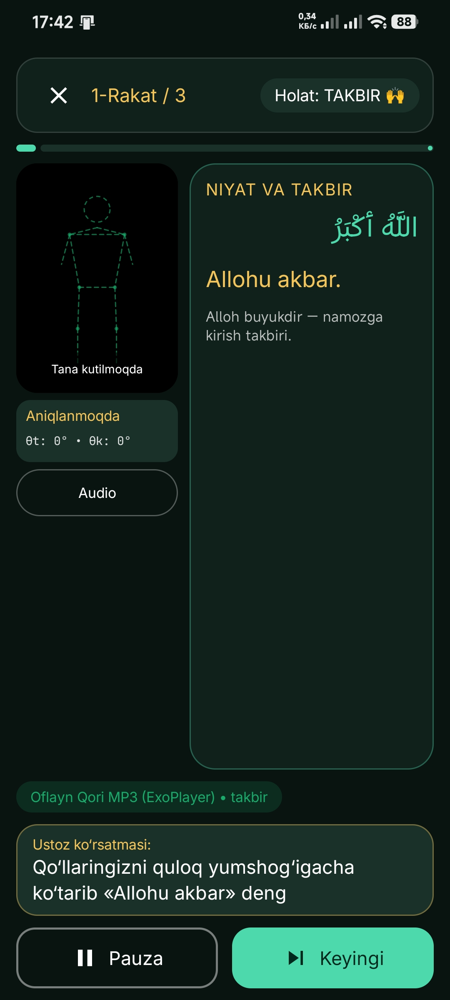
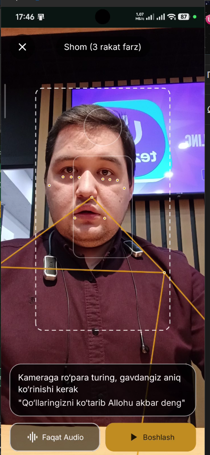
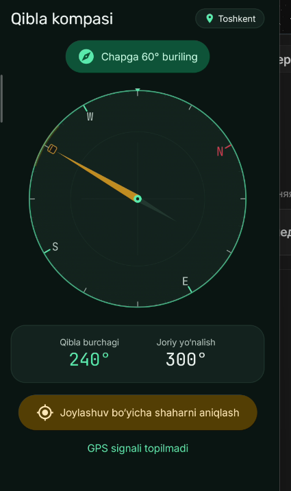
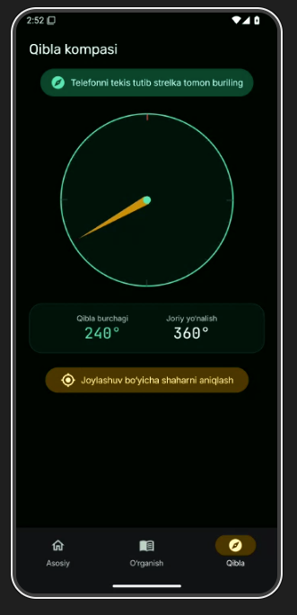
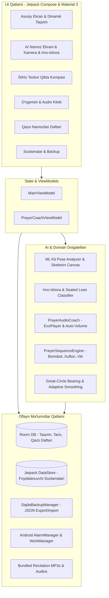

# 🕌 Namoz Ustoz AI (Намоз Устоз AI) — 100% Oflayn Aqlli Namoz Ustoz & Qibla Kompasi

<p align="center">
  
</p>

<p align="center">
  <b>Sun'iy Intellekt (Computer Vision Pose Detection) yordamida namoz ruknlarini real vaqtda o'rgatuvchi, xatolarni to'g'rilovchi va qazo namozlarini hisoblovchi 100% oflayn Android ilovasi.</b>
</p>

<p align="center">
  
  
  
  
  
  
  
</p>

---

## 📖 Loyiha Haqida (Overview)

**Namoz Ustoz AI** — yangi namoz o'rganuvchilar, bolalar, keksalar va o'z namozini mustahkamlamoqchi bo'lgan musulmonlar uchun mo'ljallangan zamonaviy virtual shaxsiy ustoz. Ilova smartfonning old kamerasidan foydalanib, foydalanuvchining tana harakatlarini (Qiyom, Ruku', Sajda, Qa'da, Salom) real vaqtda tahlil qiladi va qadam-baqadam ovozli tarzda to'g'rilab boradi.

Eng asosiysi: **Ilova ishlashi uchun internet mutlaqo shart emas!** Barcha neyron tarmoqlar (Google ML Kit Pose), 14 ta viloyatning 365 kunlik namoz vaqtlari, qori qiroatlari, qazo daftari va qibla hisob-kitoblari 100% qurilmaning o'zida (on-device) ishlaydi.

---

## ✨ Asosiy Imkoniyatlar (Key Features)

### 1. 👁️ Sun'iy Intellektli Ko'rish (Computer Vision Pose Detection)
- **CameraX + Google ML Kit Pose Detection**: Tana bo'g'inlarini (bosh, yelka, tirsak, son, tizza, to'piq) soniyasiga 30+ kadr tezlikda tahlil qiladi.
- **Ruknlarni Avtomatik Aniqlash**:
  - `QIYOM` (Tik turish — qo'llar bog'langan, bo'g'in burchaklari $\approx 180^\circ$).
  - `RUKU` (Bel egilishi — son burchagi $70^\circ - 110^\circ$, tizzalar to'g'ri, 3D frontal tahlil).
  - `SAJDA` (Bosh, tizzalar va oyoq barmoqlari yerda — bosh darajasi tizzadan past).
  - `JALSA / QA'DA` (Tashahhudda o'tirish — son va boldir bukilgan).
  - `SALAM` (Boshni o'ng va chap tomonga burish — gorizontal assimetriya orqali aniqlash).
- **Jonli Skelet Chiziqlari (Visual Pose Overlay)**: Kamera tasviri ustiga yashil rangli skelet nuqtalari va bog'lovchi chiziqlari chizilib, AI odamni to'g'ri ko'rayotganini vizual ko'rsatadi.
- **Qorong'i Xona Detektori**: Xonada yorug'lik yetarli bo'lmasa, avtomatik ravishda chiroqni yoqishni so'raydi yoki «Faqat Audio + Taymer» rejimiga o'tadi.

### 2. ♿ Kasallar va Keksalar Rejimi (Stulda / Imo-ishora bilan o'qish)
- Belida churrasi (grija), tizzasida og'rig'i bor yoki operatsiya bo'lgan insonlar uchun maxsus stulda namoz o'qish rejimi:
  - **Tik o'tirish**: `QIYOM` (qo'l ko'tarilganda `TAKBIR`);
  - **Bosh va gavdani sal egish (15°–30°)**: `RUKU`;
  - **Gavdani ruku'dan ko'ra chuqurroq egish (45°–60°+)**: `SAJDA`;
  - **Boshni burish**: `SALAM`.
- Sozlamalar va kalibrovka ekranida bitta tugma bilan yoqiladi.

### 3. 📿 Qazo Namozlari Daftari (Hanafiy fiqhi bo'yicha)
- O'zbekiston musulmonlari uchun 6 ta namoz (Bomdod, Peshin, Asr, Shom, Xufton va Vitr vojib) qazo hisoblagichi.
- Har bir o'qilgan qazo uchun bitta tugma `(-1)` orqali kamaytirish va 0 dan pastga tushib ketmaslik qulfi.
- Yillik/oylik qazolarni bir zumda qo'shish va mahalliy Room DB'da xavfsiz saqlash.

### 4. 🎙️ 100% Oflayn Ovozli Ustoz & Haqiqiy Qori Qiroati
- **Real Qori Ovozi (ExoPlayer)**: Fotiha, Ixlos, Kavsar, Falaq, An-Nos suralari hamda Attahiyyat, Salovot, Robbana duolari to'liq mahoratli qori qiroatida yangraydi.
- **O'zbekcha Yo'riqnomalar**: Namoz ruknlariga o'tishda ovozli yo'naltirish («Rukuga egiling», «Sajdaga boring», «Salom bering»).
- **Avtomatik Baland Ovoz (Auto-Boost Volume)**: Telefon polda uzoqda turgani uchun namoz boshlanganda ovozni avtomatik 85% ga ko'tarish qulayligi.

### 5. 🕋 50Hz Chaqqon Qibla Kompasi (MIUI Kompas Algoritmi)
- **Katta Doira Geodeziyasi (Great-Circle Bearing)**: Ka'ba koordinatalari ($21.4225^\circ\text{N}, 39.8262^\circ\text{E}$) bo'yicha sferik trigonometriya orqali aniq azimut.
- **50Hz SENSOR_DELAY_GAME**: Tezkor datchik o'qishi va **Adaptive Exponential Smoothing** (Tez burilganda 0 lag, to'xtaganda titrashsiz silliq).
- **Jetpack Compose 3000f Spring**: Strelka va disk 120Hz ekranlarda qo'l harakatiga yopishib aylanadi.
- **Sath Pufakchasi (Bubble Level)** va **Haptic Snap**: Qiblaga to'g'rilanganda ($\pm 5^\circ$) taktil vibratsiya va yashil nurlar.
- **Tezkor GPS / Network Shahar Aniqlash**: Bitta bosishda 300 millisekundda Toshkent yoki boshqa viloyatni aniqlash.

### 6. 📅 O'zbekistonning 14 Hududi Uchun 365 Kunlik Rasmiy Taqvim
- Toshkent shahri, Farg'ona, Andijon, Namangan, Samarqand, Buxoro, Xorazm, Navoiy, Qashqadaryo, Surxondaryo, Jizzax, Sirdaryo, Qoraqalpog'iston Respublikasi (Nukus).
- **100% Oflayn Room Database**: Internet uzilgan taqdirda ham butun yil davomida daqiqasigacha to'g'ri namoz vaqtlarini ko'rsatadi.
- **Dinamik Tezkor Tugmalar**: Hozirgi namoz vaqtiga qarab Asosiy ekranda avtomatik moslashuvchi tezkor kartalar.

### 7. 🔄 Zaxiralash va Qayta Tiklash (Backup & Restore)
- Barcha sozlamalar, qazo daftari va namozlar tarixini bitta `namoz_ustoz_ai_zaxira_YYYY-MM-DD.json` fayliga zaxiralash va xohlagan payt qayta tiklash.

---

## 📱 Ekran Lavhalari (Screenshots)

<p align="center">
  
  
  
  
</p>

---

## 🏗️ Tizim Arxitekturasi (Architecture)

Ilova **Clean Architecture + MVI/MVVM** andozalarida va **Android Jetpack Modern App Architecture** qoidalariga muvofiq qurilgan:



---

## 🛠️ Texnologiyalar Steki (Tech Stack)

| Yo'nalish | Texnologiya | Tavsif |
|---|---|---|
| **Til** | **Kotlin 2.0+** | 100% Type-safe, Null-safe zamonaviy sintaksis |
| **UI Framework** | **Jetpack Compose + Material 3** | Deklarativ, reaktiv, 120 FPS silliq animatsiyali zamonaviy dizayn |
| **Vision AI** | **Google ML Kit Pose Detection (Accurate)** | On-device 33 ta skelet nuqtalari, 3D vektor burchaklari |
| **Kamera** | **CameraX (1.4+)** | Barqaror kadrlar oqimi, `ImageAnalysis` va `Preview` |
| **Audio** | **AndroidX Media3 ExoPlayer (1.4+)** | Suralar va duolarni oflayn uzluksiz ijro etish |
| **Ma'lumotlar Bazasi** | **Android Room v3** | Taqvim, namozlar tarixi va qazo namozlari daftari |
| **Sozlamalar** | **Jetpack DataStore (Preferences)** | Jins, yozuv (Lotin/Kirill), ovoz tezligi, stulda o'qish, shahar ID |
| **Orqa Fon Xizmatlari** | **AlarmManager & WorkManager** | Aniq azon vaqti signallari (`exact_alarm`) |
| **Datchiklar** | **Android SensorManager (50Hz)** | `ROTATION_VECTOR`, `ACCELEROMETER` va `MAGNETIC_FIELD` |
| **Sinovlar (Tests)** | **JUnit4, Robolectric, Coroutines Test** | 20 ta to'plam, 80+ avtomatlashtirilgan test bilan himoyalangan |

---

## 🚀 O'rnatish va Ishga Tushirish (Quick Start & Build)

### Talablar:
- **Android Studio Ladybug (2024.2+)** yoki undan yangi versiya
- **JDK 17** yoki **JDK 21**
- **Android SDK:** `minSdk = 26` (Android 8.0 Oreo), `targetSdk = 35` (Android 15)

### 1. Repozitoriyni klonlash:
```bash
git clone https://github.com/jaskarov/Sajda-AI.git
cd Sajda-AI
```

### 2. Unit testlarni ishga tushirish:
```bash
./gradlew testDebugUnitTest
```

### 3. Debug APK yig'ish va qurilmaga o'rnatish:
```bash
# APK faylni yig'ish
./gradlew assembleDebug

# USB orqali ulangan Android qurilmaga o'rnatish (ADB)
adb install -r app/build/outputs/apk/debug/app-debug.apk

# Ilovani ishga tushirish
adb shell am start -n com.aistudio.sajdaai.uzkmpq/com.example.MainActivity
```

---

## 🔒 Xavfsizlik va Maxfiylik (Privacy & Security)

- **Zero-Secret-Leakage**: Repozitoriyda hech qanday API kalitlar, maxfiy tokenlar yoki parollar mavjud emas.
- **Kamera Maxfiyligi**: Kamera orqali olingan tasvirlar **hech qachon internetga yuborilmaydi**, serverlarga uzatilmaydi va qurilma xotirasida saqlanmaydi. Barcha tahlil faqat smartfonning RAM xotirasida, bevosita kadr uzatilayotgan soniyada qayta ishlanadi va darhol o'chiriladi.

---

## 📦 Relizlar (Releases)

Tayyor `.apk` fayllarni to'g'ridan-to'g'ri yuklab olish uchun [GitHub Releases](https://github.com/jaskarov/Sajda-AI/releases) sahifasiga o'ting.

- **v1.3.0-beta**:
  - Ilova nomi to'liq **«Namoz Ustoz AI»** ga o'tkazildi.
  - Zaxira nusxa (Backup/Restore): `namoz_ustoz_ai_zaxira_YYYY-MM-DD.json`.
  - Stulda / Imo-ishora bilan o'qish (Keksalar va kasallar uchun Qiyom, Ruku', Sajda).
  - Qazo namozlari daftari (6 ta namoz).
  - MIUI darajasidagi 50Hz chaqqon Qibla kompasi va tezkor GPS.
- **v1.2.1-beta**: 50Hz ultra-tezkor kompas va adaptiv silliqlash.
- **v1.2.0-beta**: Stulda o'qish va Qazo daftari dastlabki tatbiqi.
- **v1.1.0-beta**: Audio-First rejim, 3D frontal ruku' va kalibrovka yo'riqnomasi.
- **v1.0.0-beta**: Ilk to'liq oflayn AI namoz ustoz versiyasi.

---

## 👨‍💻 Muallif va Bog'lanish (Author & Credits)

- **Muallif**: [Javohirbek Asqarov (Jasper)](https://github.com/jaskarov)
- **GitHub**: [@jaskarov](https://github.com/jaskarov)
- **Loyiha Repozitoriysi**: [https://github.com/jaskarov/Sajda-AI](https://github.com/jaskarov/Sajda-AI)

---

<p align="center">
  <i>«Namozni to'kis ado etinglar, albatta namoz mo'minlarga vaqtida farz qilingandir.» (Niso surasi, 103-oyat)</i>
</p>
